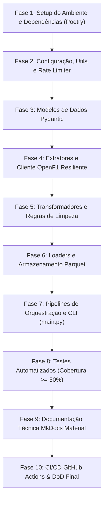

# 🏎️ Plano de Implementação: F1 Data Platform (OpenF1 Pipeline)

Este documento estabelece o plano executivo, arquitetura e roadmap passo a passo para o desenvolvimento da plataforma de engenharia de dados da Fórmula 1 (`f1`), integrando a API pública do **OpenF1** e seguindo rigorosamente os padrões de governança, qualidade e arquitetura definidos no documento canônico [SKILL.md](file:///c:/Users/Jones/projeto/F1/SKILL.md) e na documentação técnica [doc_api.md](file:///c:/Users/Jones/projeto/F1/doc_api.md).

---

## 1. Visão Geral e Objetivos do Projeto

### 1.1 Objetivo
Construir um pipeline de dados robusto, tipado, modular, resiliente e idempotente em Python para extrair, transformar e carregar (ETL/ELT) dados de Grandes Prêmios da Fórmula 1 (calendário, pilotos, tempos de volta, paradas nos boxes, clima, mensagens de direção de prova e telemetria de alta frequência) a partir da **OpenF1 API** para uma camada analítica em formato **Parquet particionado**.

### 1.2 Princípios Não-Negociáveis (Governança SKILL.md)
1. **Gerenciamento exclusivo via Poetry**: Virtualenv local obrigatório (`.venv`), sem uso de `pip install`.
2. **Arquitetura modular em `src/`**: Pacote principal sob `src/f1/` com separação estrita de responsabilidades (SRP).
3. **Padrão único de código com Ruff**: Formatação, linter e organização de imports (`isort`) padronizados.
4. **Qualidade e Cobertura Pytest**: Cobertura de testes unitários mínima de **50%** (`--cov-fail-under=50`) com mocks rigorosos (zero chamadas externas em testes).
5. **Documentação Viva com MkDocs Material**: Site estático e docstrings em Google Style com validação em modo estrito (`--strict`).
6. **Engenharia de Dados Resiliente**: Timeouts explícitos, backoff exponencial, respeito ao rate limit da API (~3 req/s), idempotência e manipulação estrita de fuso horário em **UTC**.

---

## 2. Stack Tecnológica e Ferramentas

| Categoria | Tecnologia / Biblioteca | Finalidade |
| :--- | :--- | :--- |
| **Linguagem & Runtime** | Python 3.13+ | Runtime moderno com type hints nativos avançados |
| **Dependency Manager** | Poetry | Gestão determinística de dependências e ambientes virtuais |
| **Configurações & Validação** | `pydantic`, `pydantic-settings` | Validação de schemas e settings com fail-fast |
| **Cliente HTTP & Resiliência** | `requests`, `urllib3` | Chamadas REST com connection pooling e retry |
| **Processamento & Dados** | `pandas`, `pyarrow` | Normalização tabular e escrita em Parquet colunar otimizado |
| **Linter & Formatter** | `ruff` (grupo `dev`) | Análise estática, linting e formatação ultra-rápida |
| **Testes & Cobertura** | `pytest`, `pytest-cov`, `pytest-mock` | Testes unitários com AAA e validação de cobertura |
| **Documentação Técnica** | `mkdocs`, `mkdocs-material`, `mkdocstrings[python]` | Documentação técnica com geração estática e docstrings |

---

## 3. Arquitetura Modular do Pacote (`src/f1`)

Seguindo a estrutura canônica especificada no `SKILL.md`, o projeto será organizado da seguinte forma:

```text
F1/
├── src/
│   └── f1/
│       ├── __init__.py
│       ├── main.py                     # Ponto de entrada CLI (execução de pipelines)
│       ├── config/                     # Gestão de variáveis e configurações
│       │   ├── __init__.py
│       │   └── settings.py             # Pydantic Settings (API URL, timeouts, storage)
│       ├── models/                     # Schemas de validação e tipagem (Pydantic v2)
│       │   ├── __init__.py
│       │   ├── meeting.py              # Entidades de Meeting e Session
│       │   ├── driver.py               # Pilotos e Equipes
│       │   ├── lap.py                  # Voltas, setores e tempos
│       │   ├── telemetry.py            # Car data e localizações na pista
│       │   ├── race_events.py          # Pit stops, stints, intervals, positions
│       │   └── race_control.py         # Weather, mensagens da direção, rádio
│       ├── extractors/                 # Extração da OpenF1 com rate limit & retry
│       │   ├── __init__.py
│       │   ├── base.py                 # Cliente base com throttling (~3 req/s) e retry
│       │   ├── calendar_extractor.py   # Meetings e Sessions
│       │   ├── timing_extractor.py     # Laps, Pit Stops, Stints e Intervals
│       │   ├── telemetry_extractor.py  # Car Data e Location (paginado/streaming)
│       │   └── race_info_extractor.py  # Weather, Race Control, Drivers, Team Radio
│       ├── transformers/               # Regras de negócio puras, limpeza e tipagem
│       │   ├── __init__.py
│       │   ├── cleaner.py              # Normalização de tipos, NaN/None, timestamps UTC
│       │   ├── telemetry_transformer.py# Enriquecimento de telemetria e micro-setores
│       │   └── race_transformer.py     # Agregações de corrida, gaps e stints
│       ├── loaders/                    # Carga em camada de armazenamento (Parquet)
│       │   ├── __init__.py
│       │   ├── base.py                 # Interface abstrata de loader
│       │   └── parquet_loader.py       # Gravador Parquet com particionamento e overwrite
│       ├── pipelines/                  # Orquestração do fluxo ETL
│       │   ├── __init__.py
│       │   ├── session_pipeline.py     # Pipeline completo por session_key
│       │   └── historical_pipeline.py  # Pipeline por temporada/reunião
│       ├── services/                   # Serviços de orquestração externa e clientes
│       │   ├── __init__.py
│       │   └── openf1_client.py        # Gateway unificado para a API OpenF1
│       └── utils/                      # Transversais
│           ├── __init__.py
│           ├── logger.py               # Logging estruturado em formato seguro
│           ├── rate_limiter.py         # Limitador de taxa (Token Bucket / Leaky Bucket)
│           └── exceptions.py           # Exceções customizadas do domínio F1
├── tests/
│   ├── conftest.py                     # Mocks de dados OpenF1 e fixtures Pytest
│   ├── unit/                           # Testes unitários puros (sem rede/disco real)
│   │   ├── test_config.py
│   │   ├── test_rate_limiter.py
│   │   ├── test_models.py
│   │   ├── test_extractors.py
│   │   ├── test_cleaner.py
│   │   ├── test_loaders.py
│   │   └── test_pipelines.py
│   └── integration/                    # Testes de integração de fluxo com mocks
│       └── test_session_pipeline_integration.py
├── docs/                               # MkDocs Material
│   ├── index.md
│   ├── architecture.md
│   ├── openf1_api.md
│   └── pipelines.md
├── .github/
│   └── workflows/
│       └── ci.yml                      # CI: Ruff lint/format, Pytest cov >= 50%, MkDocs strict
├── .env.example                        # Variáveis de ambiente modelo
├── .gitignore                          # Ignorar .venv, data/, .pytest_cache, etc.
├── .python-version                     # 3.13
├── pyproject.toml                      # Manifesto do projeto e ferramentas
├── poetry.lock                         # Lock determinístico
├── mkdocs.yml                          # Configuração do site de documentação
└── README.md                           # Visão geral do repositório
```

---

## 4. Mapeamento dos Endpoints da OpenF1 API

Conforme detalhado no `doc_api.md`, a API pública opera em `https://api.openf1.org/v1` com limite comunitário de **~3 requisições por segundo**.

| Endpoint | Parâmetros Chave | Volume Estimado | Estratégia de Ingestão |
| :--- | :--- | :--- | :--- |
| **`/meetings`** | `year`, `meeting_key`, `country_name` | Baixo (~24 eventos/ano) | Ingestão em lote / Full Refresh |
| **`/sessions`** | `meeting_key`, `session_key`, `session_name` | Baixo (~120 sessões/ano) | Ingestão por evento |
| **`/drivers`** | `session_key`, `driver_number` | Baixo (~20-22 registros/sessão) | Ingestão por sessão |
| **`/laps`** | `session_key`, `driver_number`, `lap_number` | Médio (~1.000 voltas/GP) | Particionamento por `meeting_key/session_key` |
| **`/pit`** | `session_key`, `driver_number` | Baixo (~40-80 paradas/GP) | Particionamento por sessão |
| **`/stints`** | `session_key`, `driver_number` | Baixo (~60-90 stints/GP) | Particionamento por sessão |
| **`/intervals`** | `session_key`, `interval<=...` | Médio-Alto (atualizado a cada volta) | Particionamento por sessão |
| **`/positions`** | `session_key`, `driver_number` | Médio (~4s de intervalo) | Particionamento por sessão |
| **`/weather`** | `session_key` | Baixo (~1 registro a cada minuto) | Particionamento por sessão |
| **`/race_control`** | `session_key`, `category`, `flag` | Baixo-Médio (eventos pontuais) | Particionamento por sessão |
| **`/team_radio`** | `session_key`, `driver_number` | Baixo-Médio (metadados de áudio) | Particionamento por sessão |
| **`/car_data`** | `session_key`, `driver_number`, `date>=...` | **Crítico / Muito Alto** (~3.7 Hz)| Streaming / Batch com filtros temporais |
| **`/location`** | `session_key`, `driver_number`, `date>=...` | **Crítico / Muito Alto** (~3.7 Hz)| Streaming / Batch com filtros temporais |

---

## 5. Estratégias de Engenharia de Dados

### 5.1 Throttling e Rate Limiting (~3 req/s)
- Implementação de um `RateLimiter` baseado em Token Bucket ou janela deslizante no pacote `src/f1/utils/rate_limiter.py`.
- Todas as requisições passam pelo middleware de rate limit para garantir que **nunca excedam 3 requisições por segundo**, evitando bloqueios HTTP 429.

### 5.2 Resiliência com Retries e Timeouts Explícitos
- Política com `urllib3.util.Retry` cobrindo status `429`, `500`, `502`, `503`, `504` com recuo exponencial e jitter.
- Timeout obrigatório configurado em tupla: `(connect_timeout=5.0, read_timeout=30.0)`.

### 5.3 Idempotência e Particionamento no Data Lake (Parquet)
- Estrutura de armazenamento analítico particionado:
  ```text
  data/
  ├── raw/                    # Carga bruta/bronze em JSON comprimido ou staging
  └── processed/              # Camada processed/silver em Parquet particionado
      ├── meetings/year=YYYY/
      ├── sessions/year=YYYY/meeting_key=MM/
      ├── laps/meeting_key=MM/session_key=SS/
      ├── telemetry/meeting_key=MM/session_key=SS/driver_number=DD/
      └── weather/meeting_key=MM/session_key=SS/
  ```
- **Partition Overwrite**: A reexecução de uma sessão ou fim de semana substitui atomicamente a partição correspondente, garantindo resultado idêntico (idempotente).

### 5.4 Padronização Temporal UTC
- Todos os campos datetime serão validados e convertidos para `timezone.utc`.
- O campo `date` em ISO 8601 UTC será a chave temporal de junção entre `/car_data`, `/location` e `/race_control`.

### 5.5 Observabilidade e Logs Estruturados
- Logger customizado em `src/f1/utils/logger.py` emitindo formato estruturado com timestamp, módulo, nível de severidade e volumetria de registros processados.
- **Proibido expressamente o uso de `print()`**.

---

## 6. Roadmap Passo a Passo de Execução



### Fase 1: Setup do Ambiente e Dependências (Poetry)
1. **Configuração Local do Poetry**:
   - `poetry config virtualenvs.in-project true --local`
2. **Adição das Dependências Principais**:
   - Produção: `poetry add pandas pydantic pydantic-settings requests pyarrow`
   - Desenvolvimento: `poetry add --group dev ruff pytest pytest-cov pytest-mock mkdocs mkdocs-material mkdocstrings[python]`
3. **Configuração do `pyproject.toml`**:
   - Declarar regras do `ruff` (line-length = 88 ou 100, selects `E`, `F`, `I`, `UP`, `B`).
   - Declarar configurações do `pytest` (`--cov=f1`, `--cov-report=term-missing`, `--cov-fail-under=50`).
4. **Arquivos Base**:
   - Criar `.env.example`, `.gitignore` e atualizar o `README.md`.

### Fase 2: Configuração, Utilitários e Observabilidade
1. **`src/f1/config/settings.py`**:
   - Classe `Settings(BaseSettings)` com `OPENF1_BASE_URL`, `OPENF1_RATE_LIMIT_RPS` (padrão 3), `OPENF1_TIMEOUT_CONNECT`, `OPENF1_TIMEOUT_READ`, `DATA_OUTPUT_DIR`.
2. **`src/f1/utils/exceptions.py`**:
   - Hierarquia de exceções: `F1PlatformError`, `OpenF1APIError`, `RateLimitExceededError`, `TransformationError`, `StorageError`.
3. **`src/f1/utils/rate_limiter.py`**:
   - Limitador de taxa baseado em intervalo de tempo com precisão de milissegundos para barrar disparos > 3 req/s.
4. **`src/f1/utils/logger.py`**:
   - Configuração de logger seguro e formatado com context details.

### Fase 3: Modelagem de Dados (Pydantic Schemas)
1. **`models/meeting.py`**: Modelos `Meeting` e `Session` com datas ISO, keys inteiras e descritores.
2. **`models/driver.py`**: Modelo `Driver` (número, nome, acrônimo, cor da equipe em hex, URL de headshot).
3. **`models/lap.py`**: Modelo `Lap` (lap_number, durações de volta e setores 1, 2 e 3, flag pit out).
4. **`models/telemetry.py`**: Modelos `CarData` (speed, rpm, gear, throttle, brake, drs) e `Location` (x, y, z).
5. **`models/race_events.py`**: Modelos `PitStop`, `Stint`, `Position`, `Interval`.
6. **`models/race_control.py`**: Modelos `WeatherRecord`, `RaceControlMessage`, `TeamRadioRecord`.

### Fase 4: Extratores e Cliente OpenF1 Resiliente
1. **`extractors/base.py`**:
   - Sessão HTTP com pool de conexões, retry configurado com backoff exponencial e integração ao `RateLimiter`.
2. **`extractors/calendar_extractor.py`**:
   - Extração de reuniões (`/meetings`) e sessões (`/sessions`) com filtros por ano ou `latest`.
3. **`extractors/timing_extractor.py`**:
   - Extração de tempos de volta (`/laps`), paradas (`/pit`), pneus (`/stints`) e gaps (`/intervals`).
4. **`extractors/telemetry_extractor.py`**:
   - Extração otimizada de telemetria (`/car_data`) e coordenadas espaciais (`/location`), permitindo fatiamento temporal por piloto.
5. **`extractors/race_info_extractor.py`**:
   - Extração de clima (`/weather`), mensagens dos comissários (`/race_control`), grid (`/drivers`) e rádios (`/team_radio`).
6. **`services/openf1_client.py`**:
   - Fachada unificada que expõe métodos de alto nível para os pipelines.

### Fase 5: Transformadores e Regras de Limpeza
1. **`transformers/cleaner.py`**:
   - Conversão de strings para tipos numéricos estritos e timestamps para `datetime` UTC.
   - Tratamento de valores nulos e validação de limites físicos (ex: velocidade > 0 e < 400 km/h).
2. **`transformers/telemetry_transformer.py`**:
   - Interpolação/alinhamento de telemetria com as voltas correspondentes.
3. **`transformers/race_transformer.py`**:
   - Normalização dos tempos de pit stop e cálculo de degradação média por stint.

### Fase 6: Loaders e Armazenamento (Parquet Data Lake)
1. **`loaders/base.py`**:
   - Protocolo/Interface base para persistência de dados.
2. **`loaders/parquet_loader.py`**:
   - Escrita colunar otimizada utilizando PyArrow/Pandas com compressão Snappy.
   - Suporte a particionamento dinâmico (`partition_cols=["year", "meeting_key"]` ou similar) e atomic overwrite por partição para garantir idempotência.

### Fase 7: Pipelines de Orquestração e CLI
1. **`pipelines/session_pipeline.py`**:
   - Orquestrador principal de uma sessão completa:
     1. Extrai metadados da sessão e pilotos.
     2. Extrai voltas, intervalos, stints e pit stops.
     3. Extrai clima e mensagens da direção de prova.
     4. (Opcional) Extrai telemetria filtrada dos líderes ou piloto selecionado.
     5. Aplica transformações e validações.
     6. Grava os datasets na camada analítica em Parquet.
2. **`main.py`**:
   - CLI enxuto com argumentos (ex: `--year 2024 --country Brazil --session Race` ou `--session-key latest`).
   - Inicialização estrita apenas sob `if __name__ == "__main__":`.

### Fase 8: Testes Automatizados e Cobertura
1. **`tests/conftest.py`**:
   - Payloads mockados de exemplo baseados no `doc_api.md` (meetings, sessions, drivers, laps, car_data).
2. **Testes Unitários (`tests/unit/`)**:
   - Testar validação e parsing dos modelos Pydantic.
   - Testar o comportamento do `RateLimiter` e do backoff HTTP com `pytest-mock`.
   - Testar limpeza, conversão UTC e deduplicação nos transformers.
   - Testar escrita do `ParquetLoader` utilizando diretórios temporários (`tmp_path`).
   - Testar o fluxo completo do pipeline com extratores mockados.
3. **Garantia de Cobertura**:
   - Executar `poetry run pytest --cov=f1 --cov-report=term-missing` assegurando **>= 50%** de cobertura obrigatória.

### Fase 9: Documentação Técnica com MkDocs Material
1. **`mkdocs.yml`**:
   - Configuração do tema Material, ícone da Fórmula 1, plugins de busca e `mkdocstrings`.
2. **Arquivos em `docs/`**:
   - `docs/index.md`: Visão geral e introdução ao projeto.
   - `docs/architecture.md`: Diagrama de arquitetura, fluxo de dados e divisão de responsabilidades.
   - `docs/openf1_api.md`: Resumo dos endpoints consumidos e políticas de rate limit.
   - `docs/pipelines.md`: Instruções de execução e parâmetros da CLI.
3. **Validação**:
   - Compilação sem alertas nem erros: `poetry run mkdocs build --strict`.

### Fase 10: CI/CD e Checklist de Conclusão (Definition of Done)
1. **Workflow GitHub Actions (`.github/workflows/ci.yml`)**:
   - Passos: Setup Python -> Install dependencies -> `ruff check .` -> `ruff format --check .` -> `pytest --cov=f1 --cov-fail-under=50` -> `mkdocs build --strict`.
2. **Auditoria de Segurança**:
   - Garantir ausência de qualquer chave ou segredo no código.
   - Validar `.env.example`.

---

## 7. Matriz de Riscos e Estratégias de Mitigação

| Risco Técnico | Probabilidade | Impacto | Estratégia de Mitigação |
| :--- | :---: | :---: | :--- |
| **Bloqueio por Rate Limit (HTTP 429)** | Alta | Alto | Limitador de taxa no cliente HTTP configurado para ~2.5 req/s (margem de segurança) + retry exponencial com jitter. |
| **Explosão de Memória em `/car_data` e `/location`** | Alta | Médio-Alto | Não carregar sessões inteiras de telemetria de uma só vez na memória; processar por piloto/intervalo de voltas e persistir em chunks Parquet. |
| **Inconsistência de Tipos / Campos Omissos** | Média | Médio | Schemas Pydantic v2 com campos opcionais (`Optional[T] = None`) e validação de tipos na camada de ingestão. |
| **Falha de Rede Intermitente** | Média | Baixo | Timeouts explícitos em todas as chamadas e política de até 5 retentativas para erros transientes. |
| **Duplicação de Dados em Reexecuções** | Média | Médio | Idempotência garantida via sobrescrita de partição (`partition overwrite`) no armazenamento Parquet. |

---

## 8. Checklist de Entrega (Definition of Done)

Para cada etapa desenvolvida, os seguintes critérios devem ser estritamente cumpridos antes do aceite final:

- [ ] Todas as novas dependências foram adicionadas via `poetry add` (com `--group dev` para ferramentas de desenvolvimento).
- [ ] O código segue a arquitetura modular em `src/f1/` com imports absolutos (`from f1...`).
- [ ] O código passou sem avisos no Ruff (`poetry run ruff check . --fix` e `poetry run ruff format .`).
- [ ] Testes unitários foram criados e a cobertura geral do pacote `f1` é de no mínimo **50%** (`poetry run pytest`).
- [ ] O site de documentação compila sem falhas (`poetry run mkdocs build --strict`).
- [ ] Todas as funções e métodos possuem docstrings no padrão Google Style e type hints completos.
- [ ] O `.env.example` está atualizado e nenhuma credencial foi exposta.
