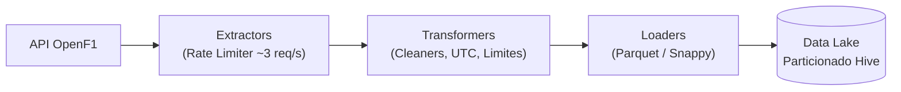

# 🏛️ Arquitetura da Plataforma

A plataforma adota o padrão canônico de layout sob `src/` e segue os princípios de responsabilidade única (SRP), importações absolutas e isolamento de efeitos colaterais.

---

## 📐 Estrutura de Módulos

```text
src/f1/
├── config/              # Variáveis e configurações validadas (Pydantic Settings)
├── models/              # Contratos de dados e schemas tipados (Pydantic v2)
├── extractors/          # Clientes HTTP especializados com retry e rate limiting
├── transformers/        # Regras de limpeza puras, cálculos de corrida e telemetria
├── loaders/             # Persistência colunar em Apache Parquet
├── pipelines/           # Orquestração do fluxo ETL (Session e Historical)
├── services/            # Gateway unificado OpenF1Client
├── utils/               # RateLimiter, logger estruturado e exceções do domínio
└── main.py              # Ponto de entrada CLI enxuto
```

---

## 🔄 Fluxo de Dados (ETL)



---

## 🛡️ Princípios de Engenharia de Dados

1. **Gestão Exclusiva com Poetry**: Ambiente isolado em `.venv`, sem comandos `pip`.
2. **Rate Limiting Defensivo**: Token bucket/mínimo espaçamento temporal para evitar HTTP 429.
3. **Padrão AAA em Testes**: Mocks estritos sem chamadas reais à rede e cobertura obrigatória de no mínimo 50%.
4. **Idempotência**: Escrita com `existing_data_behavior='delete_matching'`, substituindo apenas a partição processada.
